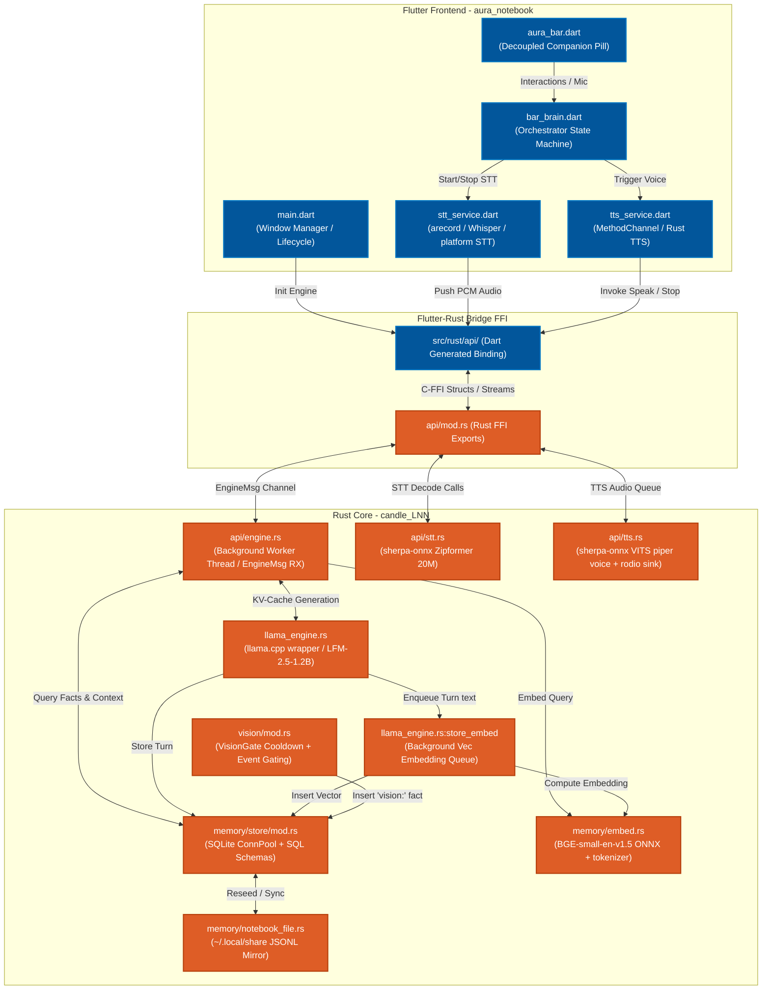

# Project AURA - System Mindmap & Architecture

This document serves as the master **human-readable dependency, dataflow, and structural mindmap** of the entire Project AURA codebase. Use this map as a jump-table for debugging integration, FFI, memory, and voice issues.

---

## 1. Core Architecture Mindmap

The diagram below details the exact integration between the **Flutter UI Layer**, the **Flutter-Rust Bridge (FRB) FFI Layer**, and the localized **Rust Inference Engine (candle_LNN)**.



---

## 2. Subsystem Breakdowns

For detailed explanations of each folder and their internals, follow the links to the subsystem documents:

1. [**Bar UI Subsystem** (bar_ui)](file:///home/pratay-karali/launch-AURA/explain/bar_ui/README.md)
   - Coordinates the overlay UI, state transitions (`idle`, `listening`, `processing`, `speaking`, `proactive`, `learning`), and multi-process window communication.
2. [**LLM Engine Subsystem** (llm_engine)](file:///home/pratay-karali/launch-AURA/explain/llm_engine/README.md)
   - Manages the `llama.cpp` model context, samplers, and token-streaming loops. Handles the variable-length generation planner.
3. [**Memory Subsystem** (memory)](file:///home/pratay-karali/launch-AURA/explain/memory/README.md)
   - Operates the SQLite schema containing conversation turns, vector search tables (`vec_memory`), custom facts/insights, and RL proactive triggers. Includes the localized `BGE-small` embedder and durable JSONL mirror.
4. [**Voice Subsystem** (stt_tts)](file:///home/pratay-karali/launch-AURA/explain/stt_tts/README.md)
   - Powers the text-to-speech (sherpa-onnx VITS / piper) and speech-to-text (sherpa-onnx Zipformer / Python whisper server) engines.
5. [**Vision Subsystem** (vision)](file:///home/pratay-karali/launch-AURA/explain/vision/README.md)
   - Gathers object detection logs, runs cooldown checks, and injects visible items into the context buffer prefixed as `vision:`.
6. [**Model & Mitacs Sandbox Details**](file:///home/pratay-karali/launch-AURA/explain/model_and_mitacs_details.md)
   - Elaborates on the LFM (Gated Delta Net recurrent model) properties, BGE ONNX embedders, and the Mitacs memory evaluation sandbox results.
7. [**Deep Integration & Voice/Memory Performance Details**](file:///home/pratay-karali/launch-AURA/explain/deep_integration_and_performance.md)
   - Detailed analysis of the FFI thread orchestration, voice subsystem flows, diagnostic bugs to resolve, and memory data structures.

---

## 3. Subsystem Interactions & Data Flows

### A. The Chat RAG Flow (Text Pipeline)
```
User Prompt (Flutter)
   │
   ▼
[api/engine.rs: process_chat()] ──► [memory/embed.rs] (Embed user query)
   │                                      │
   │◄─────────────────────────────────────┘
   ▼
[memory/store/mod.rs: search_relevant()] (Cosine similarity search on RAG)
   │
   ▼
Inject Facts + RAG Context + Context Summaries + Insights + Turns
   │
   ▼
[llama_engine.rs: generate_with_context()] ──► Prefills KV-cache, decodes prompt,
   │                                           and streams tokens back to Flutter
   ▼
[llama_engine.rs: store_embed()] ─────► Background worker computes passage embedding
                                         and inserts into SQLite vec_memory
```

### B. Speech Input / Output Flow (Voice Pipeline)
```
[Mic Button Tap] ──► [stt_service.dart] ──► (Linux Desktop fallback: spawns arecord)
                                       ──► (Android: Native speech_to_text)
                                       ──► (Rust: push_audio to sherpa-onnx Zipformer)
                                                │
   ┌────────────────────────────────────────────┘
   ▼
Transcribed Text ──► Chat Pipeline ──► Output Token Sentences
                                                │
   ┌────────────────────────────────────────────┘
   ▼
[tts_service.dart] ──► [api/tts.rs] ──► OfflineTts (VITS/Piper) ──► rodio Audio Sink
                   ──► MethodChannel ──► Native Android TTS API
```

---

## 4. Current Diagnostic & Architectural Issues

Below is a combined summary of active errors and runtime anomalies identified in the project diagnostic logs:

| Category | Issue Description | Root Cause / File Location | Impact |
| :--- | :--- | :--- | :--- |
| **Android Overlay** | **Background Mic Permission Block** | Promotes `OverlayService` with media-playback only: [OverlayService.java#L251-L256](file:///home/pratay-karali/launch-AURA/AURA-Proj/aura_notebook/plugins/flutter_overlay_window/android/src/main/java/flutter/overlay/window/flutter_overlay_window/OverlayService.java#L251-L256) | Background process cannot record mic audio; throws silent/crash Exception. |
| **Android Overlay** | **Dynamic Resize Bounds Bug** | Invalid logical operator `||` in height check: [OverlayService.java#L427-L438](file:///home/pratay-karali/launch-AURA/AURA-Proj/aura_notebook/plugins/flutter_overlay_window/android/src/main/java/flutter/overlay/window/flutter_overlay_window/OverlayService.java#L427-L438) | Overlay expansion triggers layout failures or window clipping. |
| **Android Overlay** | **Touch Input Capture** | Width set to `matchParent` to center-align the pill: [android_overlay_service.dart#L64-L74](file:///home/pratay-karali/launch-AURA/AURA-Proj/aura_notebook/lib/services/android_overlay_service.dart#L64-L74) | Invisible overlay bounds block touches to background applications. |
| **Android Overlay** | **Keyboard Focus Block** | Opened overlay starts with `FLAG_NOT_FOCUSABLE` by default: [WindowSetup.java#L37-L48](file:///home/pratay-karali/launch-AURA/AURA-Proj/aura_notebook/plugins/flutter_overlay_window/android/src/main/java/flutter/overlay/window/flutter_overlay_window/WindowSetup.java#L37-L48) | User cannot tap to focus text fields or type inside the overlay. |
| **Linux Voice** | **ONNX sample_rate Probe Failure** | VITS Piper ONNX models missing sample rate properties inside graph metadata: [tts.rs#L39-L103](file:///home/pratay-karali/launch-AURA/AURA-Proj/candle_LNN/aura_lnn/src/api/tts.rs#L39-L103) | `aura_tts_init()` returns `false`, causing silent fallback to EdgeTTS or silent timer simulation. |
| **Linux Voice** | **Rust STT Unreachable Block** | Duplicate check for `Platform.isLinux` returns early, bypassing Android block: [stt_service.dart#L92-L117](file:///home/pratay-karali/launch-AURA/aura_notebook/lib/services/stt_service.dart#L92-L117) | Bypasses Rust Zipformer initialization on Linux. |
| **Linux Voice** | **ALSA Device Lock Conflict** | Spawns two concurrent `arecord` processes (one for WAV, one for live sound level indicator) | EBUSY error on audio configurations without PulseAudio/PipeWire backend mixing. |
| **Linux Voice** | **Zombie Whisper Processes** | Python Whisper server child process is not cleaned up if the main application crashes | Persistent background python processes leak system VRAM and CPU resource bounds. |
